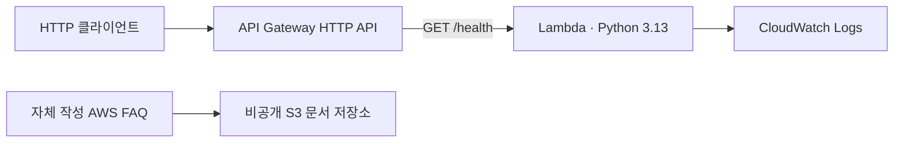

# CloudMate — AWS 학습 지원 RAG 챗봇

CloudMate는 클라우드 아키텍처 수업의 텀프로젝트로 개발하는 AWS 학습 지원 챗봇입니다. AWS 공식 기술 문서, 공개 실습 가이드, 자체 작성 FAQ를 검색하여 질문에 대한 답변과 근거 자료를 제공하는 것을 목표로 합니다. AWS를 처음 배우는 학생과 실습 중인 개발자를 주요 대상으로 합니다.

**2026년 11월 25일 과제 제출 후 CloudMate AWS 리소스를 모두 정리했습니다. 코드·SAM 설정·FAQ·실행 증거는 보관하고, 다음 개발 시 새 환경을 배포합니다.** 문서 검색·임베딩·생성 모델 호출과 웹 채팅 화면은 후속 개발 범위입니다.

| 항목 | 내용 |
|---|---|
| GitHub 저장소 | [MikGiNwong/cloudmate-rag-chatbot](https://github.com/MikGiNwong/cloudmate-rag-chatbot) · 공개 저장소 |
| AWS 리전 | 서울 `ap-northeast-2` |
| 현재 AWS 상태 | 과제 제출 후 리소스 삭제 완료 · API 종료 |
| 개발 재개 | [AWS 재배포 안내](docs/redeployment.md) |
| 검증 기준일 | 2026년 11월 25일 |
| 설계 문서 | [1주차 설계 요약](docs/week1/design_summary.md) |
| 실습 보고서 | [환경 구성 보고서](docs/environment_report.md) |

## 1. 서비스 개발 목표

1주차 설계에 따라 다음 기능을 단계적으로 구현할 계획입니다.

- AWS 관련 질문에 대해 검색한 문서를 근거로 답변합니다.
- 답변과 함께 참고 문서의 제목과 원본 URL을 제공합니다.
- 등록된 가이드에 근거하여 실습 절차를 단계별로 안내합니다.
- 필요한 AWS 서비스와 연결 관계를 추출하고, AWS 공식 아이콘을 활용해 실습 아키텍처를 시각화합니다.
- 관련 자료가 부족하면 근거가 부족하다는 안내를 제공합니다.

## 2. 구현 및 검증 결과

| 과제 항목 | 구현 내용 | 확인 결과 |
|---|---|---|
| 개발 환경 | Python 3.13, AWS CLI, SAM CLI, Git, GitHub CLI 구성 | 환경 확인 및 인증 완료 |
| 인프라 관리 | SAM·CloudFormation으로 리소스 정의 및 배포 | `cloudmate` 스택 `UPDATE_COMPLETE` |
| 테스트 API | Lambda와 HTTP API의 `GET /health` 연결 | 실제 HTTP 200 및 응답 JSON 일치 |
| 문서 저장 | 자체 작성 AWS FAQ를 S3의 `documents/aws-faq.txt`에 저장 | 업로드·다운로드 성공, 원본과 SHA-256 일치 |
| 접근 권한 | 비공개 S3와 함수 전용 IAM 실행 역할 구성 | 버킷 보안 설정·실제 정책 확인 |
| 모니터링 | CloudWatch Logs에 함수 실행 로그 기록 | 실제 호출 로그 및 7일 보존 설정 확인 |
| 소스 관리 | Git 커밋 및 GitHub 원격 저장소 연동 | 커밋 푸시와 로컬·원격 해시 일치 확인 |

단위 테스트 10개, Python 문법 검사, SAM 템플릿 검증과 빌드를 통과했습니다. 실행 결과는 [검증 증거 목록](docs/evidence/README.md)에서 확인할 수 있습니다. 표의 결과는 검증 기준일에 수행한 실습을 기준으로 합니다.

## 3. 배포 시 시스템 구성



아래 구성은 배포 시 생성하는 구조이며 현재 AWS 리소스는 삭제된 상태입니다. 상태 API는 API Gateway를 통해 Lambda를 호출하고 실행 로그를 CloudWatch에 기록합니다. S3는 이후 RAG 데이터 소스로 사용할 문서를 저장합니다. 현재 상태 API는 문서 검색이나 모델 호출을 수행하지 않습니다.

| 역할 | 적용 기술 |
|---|---|
| 백엔드 | Python 3.13, AWS Lambda `arm64` |
| API | Amazon API Gateway HTTP API |
| 원본 문서 저장 | Amazon S3 |
| 인프라 코드 | AWS SAM, AWS CloudFormation |
| 접근 제어 및 로그 | AWS IAM, Amazon CloudWatch |
| 개발 및 소스 관리 | VS Code, Codex, Git, GitHub |

리소스 이름과 태그에는 주차 번호를 사용하지 않습니다. 세부 리소스 설정은 [인프라 구성 설명](infrastructure/README.md)과 [SAM 템플릿](infrastructure/template.yaml)에 정리했습니다.

## 4. 상태 확인 API의 검증 기록

```text
GET https://b1prf542b3.execute-api.ap-northeast-2.amazonaws.com/health
```

다음 주소와 응답은 과제 제출 전 실제 배포 검증 기록입니다. 현재 해당 API는 종료됐으며, 재배포 시 새 주소를 사용합니다. 당시 HTTP `200 OK`와 `application/json` 응답을 확인했습니다.

```json
{
  "status": "ok",
  "service": "CloudMate",
  "message": "AWS Lambda is working"
}
```

재배포 후 새 `HealthApiUrl`을 `CLOUDMATE_HEALTH_URL`에 지정해 상태 코드와 응답 본문을 확인합니다. 주소 조회 명령은 [재배포 안내](docs/redeployment.md)에 있습니다.

```sh
curl -i "$CLOUDMATE_HEALTH_URL"
```

[실제 HTTP 응답 기록](docs/evidence/api_http.json)에 검증 시각과 결과를 보관했습니다. 현재 삭제 상태와 확인 결과는 [리소스 정리 증거](docs/evidence/final_cleanup_verification.json)에 기록했습니다.

## 5. 프로젝트 구조

```text
cloudmate-rag-chatbot/
├── backend/
│   ├── health/                 # Lambda 상태 API 및 런타임 의존성
│   └── tests/                  # API·검증 스크립트 단위 테스트
├── frontend/                   # React 프론트엔드 개발 범위
├── data/
│   └── aws-faq.txt             # 출처를 포함한 자체 작성 FAQ
├── infrastructure/
│   ├── template.yaml           # AWS SAM 인프라 정의
│   └── README.md               # 리소스 구성 및 배포 설명
├── docs/
│   ├── week1/design_summary.md # 개인정보를 제외한 1주차 설계 요약
│   ├── environment_report.md  # 현재 환경 구성 보고서
│   ├── submission_guide.md    # 제출 자료·화면 촬영 안내
│   └── evidence/              # 현재 구성의 실제 검증 증거
├── scripts/verify_api.py       # 실제 HTTP 응답 검증
├── requirements-dev.txt        # SAM CLI 등 개발 도구 의존성
├── samconfig.toml              # 리전·스택·배포 설정
├── AGENTS.md                   # 개발·테스트·보안 작업 지침
└── README.md
```

1주차 원본 DOCX와 인증 정보, 로컬 가상환경, 빌드 산출물은 공개 저장소에서 제외했습니다.

## 6. 로컬 실행 및 테스트

Python 3.13과 Git이 필요합니다. AWS 배포에는 별도로 AWS CLI v2와 배포 권한이 있는 AWS 프로파일을 사용합니다.

```sh
git clone https://github.com/MikGiNwong/cloudmate-rag-chatbot.git
cd cloudmate-rag-chatbot
python3.13 -m venv .venv
source .venv/bin/activate
python -m pip install -r requirements-dev.txt

python -m compileall -q backend scripts
python -m unittest discover -s backend/tests -v
sam validate --lint --template-file infrastructure/template.yaml --region ap-northeast-2
sam build
```

상태 API는 Python 표준 라이브러리로 구현했습니다. 이번 빌드는 Docker 없이 수행했으며, `sam local`을 통한 Lambda 에뮬레이션을 사용하려면 Docker가 필요합니다.

AWS를 재배포한 뒤 새 API의 상태·Content-Type·JSON을 함께 검증하려면 다음 명령을 실행합니다.

```sh
python scripts/verify_api.py "$CLOUDMATE_HEALTH_URL"
```

macOS Python에서 `CERTIFICATE_VERIFY_FAILED`가 발생하면 가상환경에 설치된 CA 번들을 지정한 뒤 다시 실행할 수 있습니다. TLS 인증서 검증은 유지합니다.

```sh
export SSL_CERT_FILE="$(python -m certifi)"
```

## 7. AWS 배포 방법

현재 환경은 삭제되어 있으므로 다음 개발을 재개할 때만 실행합니다. 전체 복구 순서는 [AWS 재배포 안내](docs/redeployment.md)를 따릅니다.

루트의 `samconfig.toml`에 리전 `ap-northeast-2`, 스택 `cloudmate`, IAM 리소스 생성 설정과 변경 세트 확인 옵션을 보존했습니다. AWS 프로파일 인증을 완료한 후 프로젝트 루트에서 실행합니다.

```sh
source .venv/bin/activate
export AWS_PROFILE=cloudmate
export SAM_CLI_TELEMETRY=0
sam build
sam deploy
```

배포 시 문서용 S3 버킷, Lambda 함수, HTTP API, IAM 실행 역할과 로그 그룹을 생성합니다. SAM은 별도 관리 스택과 S3 버킷에 배포 패키지를 저장합니다. 변경 세트를 검토한 후 배포하며, 스택은 `cloudmate`, API는 `cloudmate-http-api`라는 이름을 사용합니다. 함수 이름 `cloudmate-health-check`는 같은 계정·리전에서 중복 사용할 수 없습니다.

배포 완료 후 CloudFormation 출력의 `HealthApiUrl`로 API를 검증합니다. 테스트 문서는 출력의 `DocumentsBucketName`을 사용해 업로드합니다.

```sh
CLOUDMATE_BUCKET="$(aws cloudformation describe-stacks --stack-name cloudmate --region ap-northeast-2 --query 'Stacks[0].Outputs[?OutputKey==`DocumentsBucketName`].OutputValue | [0]' --output text)"
aws s3 cp data/aws-faq.txt "s3://$CLOUDMATE_BUCKET/documents/aws-faq.txt" --content-type 'text/plain; charset=utf-8' --region ap-northeast-2
aws s3api head-object --bucket "$CLOUDMATE_BUCKET" --key documents/aws-faq.txt --region ap-northeast-2
```

## 8. 보안 및 환경 정리

2026년 11월 25일 CloudMate 스택과 SAM 관리 스택, 문서·패키지 버킷의 모든 객체 버전, 함수·API·역할·로그 그룹을 삭제하고 잔여 리소스가 없음을 확인했습니다. 로컬 개발 도구와 GitHub 자료는 유지합니다. 아래 내용은 배포 시 적용하는 보안 설정과 이후 정리 절차입니다.

S3에는 퍼블릭 액세스 전체 차단, AES256 기본 암호화, ACL 비활성화와 버전 관리를 적용했습니다. Lambda 실행 역할은 해당 함수의 로그 그룹에 스트림 생성·이벤트 기록만 허용하며, S3나 Bedrock 접근 권한은 부여하지 않았습니다. 상태 API에는 초당 2건·버스트 5건의 기본 스로틀링을 설정했습니다.

API 요청, 함수 실행, S3 저장·요청, 로그 보관과 패키지 버킷의 암호화 요청 등에 사용료가 발생할 수 있습니다. 스로틀링은 비용 상한을 보장하지 않습니다. 현재 구성에는 EC2, NAT Gateway, RDS, OpenSearch와 Bedrock 추론이 포함되지 않습니다.

실습 종료 후에는 보관할 문서와 로그를 확인하고 스택을 정리합니다. 아래 명령은 배포 리소스를 삭제하므로 환경 정리를 결정한 경우에만 실행합니다.

```sh
aws cloudformation delete-stack --stack-name cloudmate --region ap-northeast-2
aws cloudformation wait stack-delete-complete --stack-name cloudmate --region ap-northeast-2
```

문서 버킷과 로그 그룹은 `Retain` 정책에 따라 스택 삭제 후에도 남습니다. 버전 관리 버킷을 완전히 비우려면 객체의 모든 버전과 삭제 마커도 정리해야 합니다. SAM 패키지 버킷과 관리 스택은 다른 프로젝트의 사용 여부를 확인한 뒤 별도로 정리합니다.

## 9. 향후 개발 계획

1주차 설계의 데이터 준비 흐름인 S3 문서 수집 → Bedrock Knowledge Bases 텍스트 추출·분할 → Titan Text Embeddings V2 임베딩 → S3 Vectors 저장을 구현할 예정입니다.

질문 처리에는 React·Amplify Hosting, API Gateway·Lambda, Knowledge Bases 검색과 Claude Sonnet 계열 모델을 연결할 계획입니다. 이후 출처 표시, 근거 부족 시 답변 제한, 단계별 실습 안내와 AWS 공식 아이콘을 사용하는 아키텍처 시각화를 추가합니다.

환경 구성 보고서에 필요한 AWS 서비스, 개발 환경, 저장소 주소와 기본 실행 확인 화면의 준비 방법은 [제출 안내](docs/submission_guide.md)에 정리했습니다.
