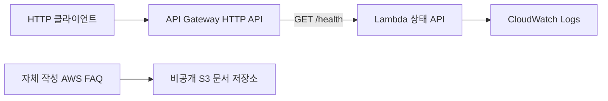

# CloudMate 환경 구성 보고서

작성일: 2026년 11월 25일

**운영 상태 갱신:** 과제 제출 후 2026-11-25 15:04 KST에 CloudMate 리소스 삭제 완료를 확인했다. 아래 서비스 구성과 실행 결과는 제출 당시의 실제 검증 기록이며, 현재 API는 종료됐다. 소스·FAQ·실행 증거는 보존했고 [개발 재개 안내](redeployment.md)에 따라 재배포할 수 있다. [삭제 확인 증거](evidence/final_cleanup_verification.json)를 함께 보관한다.

CloudMate는 AWS 공식 문서와 실습 가이드, 자체 작성 FAQ를 바탕으로 AWS 학습을 지원하는 RAG 챗봇 텀프로젝트이다. 현재 단계에서는 개발 환경과 AWS 실행 기반을 구성하고, 상태 확인 API와 문서 저장소의 동작을 검증한다. 실제 RAG 검색·임베딩·생성 모델 호출·프론트엔드 화면은 후속 구현 범위이다.

주차가 포함된 기존 스택을 프로젝트 공통 스택 `cloudmate`로 이전하고, 현재 이름·태그·API 코드를 기준으로 실제 실행 검증을 완료했다. 기존 API 주소와 문서·함수·로그 그룹은 유지했으며, 이전 실행 역할과 호출 권한은 정리했다.

## 1. 사용한 AWS 서비스

| 서비스 | 사용 목적 | 적용 구성 |
|---|---|---|
| AWS CloudFormation·SAM | 인프라를 코드로 정의하고 배포·변경 이력 관리 | 프로젝트 스택 cloudmate |
| Amazon API Gateway | HTTP 요청을 Lambda로 전달 | HTTP API cloudmate-http-api, GET /health |
| AWS Lambda | 상태 확인 JSON 응답 생성 | cloudmate-health-check, Python 3.13, arm64, 128 MB, 제한 시간 3초 |
| Amazon S3 | 향후 RAG 원본 문서 저장 | 비공개 문서 버킷의 documents/aws-faq.txt |
| AWS IAM | 함수 실행에 필요한 최소 권한 부여 | cloudmate-HealthFunctionRole-T44As7YN4VVy — 함수 전용 로그 그룹의 CreateLogStream·PutLogEvents만 허용 |
| Amazon CloudWatch Logs | 실제 함수 호출 로그 확인 | /aws/lambda/cloudmate-health-check, 7일 보존 |

모든 프로젝트 리소스는 서울 리전 ap-northeast-2에서 관리한다. SAM은 별도 관리 스택과 S3 버킷을 배포 패키지 저장에 사용한다. 기존 설계의 Bedrock Knowledge Bases, S3 Vectors, Titan Text Embeddings V2, Claude Sonnet과 React·Amplify Hosting은 현재 생성하거나 호출하지 않는다.

## 2. 개발 환경 구성

| 항목 | 확인한 구성 |
|---|---|
| 운영체제·CPU | macOS 27.2.1, Apple Silicon arm64 |
| Python | 3.13.17, 프로젝트 가상환경 .venv |
| Git | 2.54.0 (Apple Git-157) |
| AWS CLI | 2.42.2, cloudmate 프로파일의 단기 인증 |
| AWS SAM CLI | 1.174.0, requirements-dev.txt에 버전 기록 |
| GitHub CLI | 2.105.0 |
| 개발 도구 | VS Code, Codex |
| 런타임 의존성 | Python 표준 라이브러리만 사용 |

Python 가상환경에서 개발 도구와 Lambda 실행 의존성을 구분했다. 코드는 unittest로 검증하고, SAM 템플릿은 cfn-lint를 포함한 sam validate와 sam build로 확인한다. Docker 없이 현재 함수를 빌드했으며, Lambda 로컬 에뮬레이션을 추가로 사용하려면 Docker가 필요하다.

실제 버전 출력은 [환경 확인 증거](evidence/environment_versions.txt)에 저장했다. 원본 DOCX, 인증 정보, 가상환경과 빌드 산출물은 공개 저장소에서 제외한다.

## 3. 시스템 구성과 실행 방법



API 호출 경로와 문서 저장 경로를 구성했다. 현재 상태 API는 S3 검색이나 생성 모델을 호출하지 않는다.

```sh
python3.13 -m venv .venv
source .venv/bin/activate
python -m pip install -r requirements-dev.txt
python -m unittest discover -s backend/tests -v
sam validate --lint --template-file infrastructure/template.yaml --region ap-northeast-2
sam build
```

배포 설정은 루트 samconfig.toml에 보존하며, AWS 프로파일 인증 후 sam deploy를 실행한다. 스택 이름·태그·상태 응답에는 주차 정보를 넣지 않는다.

## 4. 실제 검증 결과

검증 시각: 2026-11-25 02:46:54 KST

상태 확인 주소: https://b1prf542b3.execute-api.ap-northeast-2.amazonaws.com/health

```json
{
  "status": "ok",
  "service": "CloudMate",
  "message": "AWS Lambda is working"
}
```

| 검증 항목 | 실제 결과 | 실행 증거 |
|---|---|---|
| Python 문법·단위 테스트 | 문법 검사 성공, 테스트 10개 성공 | [문법 검사](evidence/syntax_check.txt), [단위 테스트](evidence/unit_tests.txt) |
| 인프라 검증·빌드 | SAM/cfn-lint 및 Python 3.13/arm64 빌드 성공 | [SAM 검증](evidence/sam_validation.txt), [빌드](evidence/sam_build.txt) |
| 프로젝트 스택 | cloudmate, UPDATE_COMPLETE | [리소스 조회](evidence/aws_resource_verification.json) |
| 실제 HTTP 요청 | HTTP 200, application/json, 응답 계약 일치 | [HTTP 응답](evidence/api_http.json) |
| S3 문서 보존 | 다운로드 HTTP 200, 3,920바이트와 SHA-256 일치, 기존 객체 버전 유지 | [문서 검증](evidence/s3_document_verification.json), [이전 결과](evidence/resource_migration.json) |
| 배포 코드 | ZIP의 AWS CodeSha256 및 app.py 원본 일치 | [코드 검증](evidence/lambda_code_verification.json) |
| 실제 실행 로그 | START/END/REPORT와 health_check status=ok 확인 | [CloudWatch 로그](evidence/cloudwatch_logs.txt) |
| 이름·태그 | 활성 리소스 및 태그에 주차 표시 없음 | [이전 결과](evidence/resource_migration.json) |

상태 응답은 서비스 실행 확인에 필요한 세 필드만 제공한다. 별도 cfn-guard 실행은 수행하지 않았으며, SAM/cfn-lint·변경 세트 사전 검증과 실제 보안 설정 조회를 수행했다.

## 5. GitHub 저장소

저장소 주소: https://github.com/MikGiNwong/cloudmate-rag-chatbot

공개 저장소에서 Lambda 코드, 테스트, SAM 템플릿, FAQ, 보고서와 식별 정보를 제거한 실행 증거를 관리한다. 개인정보가 포함된 1주차 원본 DOCX와 인증 자료는 업로드하지 않는다. 기본 브랜치는 main이다.

## 6. 리소스 이름 정리

기존 CloudFormation 스택 cloudmate-week2의 모든 리소스에 보존 정책을 적용한 뒤 스택을 삭제하고, 기존 리소스 7개를 cloudmate 스택으로 가져왔다. 이 과정은 리소스의 물리 ID와 데이터를 보존한다. 이후 SAM 변경 세트로 API 표시 이름과 태그·설명·상태 API 코드를 갱신하고, 이름 변경이 불가능한 실행 역할과 호출 허용 문장을 교체했다. 이전 역할과 호출 권한은 새 역할·권한으로 전환된 것을 확인한 뒤 삭제했다.

관련 절차는 AWS의 [스택 이름 변경 시 리소스 보존](https://aws.amazon.com/blogs/infrastructure-and-automation/keep-your-aws-resources-when-you-rename-an-aws-cloudformation-stack/)과 [리소스 가져오기](https://docs.aws.amazon.com/AWSCloudFormation/latest/UserGuide/import-resources-manually.html)를 기준으로 확인했다. 가져오기 단계에서는 Outputs와 스택 태그 변경을 분리하고, 후속 SAM 배포에서 적용했다.

| 항목 | 현재 구성과 처리 결과 |
|---|---|
| 프로젝트 스택 | cloudmate, UPDATE_COMPLETE. 이전 스택은 DELETE_COMPLETE |
| HTTP API | cloudmate-http-api. API ID와 주소 유지 |
| Lambda | cloudmate-health-check. 함수 유지, 코드·역할 갱신 |
| IAM 실행 역할 | cloudmate-HealthFunctionRole-T44As7YN4VVy. 이전 주차 이름 역할 삭제 |
| 문서 버킷 | `cloudmate-docs-<AWS_ACCOUNT_ID>-ap-northeast-2`. 문서·버전 보존 |
| 로그 그룹 | /aws/lambda/cloudmate-health-check. 기존 로그·7일 보존 설정 유지 |
| 배포 패키지 저장소 | 주차가 없는 SAM 관리 스택·버킷 재사용 |

[이전 및 정리 증거](evidence/resource_migration.json)를 보관했다. 삭제된 스택 이력이나 이전 실행 로그에는 당시 이름이 남을 수 있으나, 현재 활성 구성에는 주차 이름·태그가 없다.

## 7. 보안과 비용 관리

문서 버킷은 퍼블릭 액세스 전체 차단, AES256 기본 암호화, ACL 비활성화와 버전 관리를 사용한다. Lambda에는 지정 로그 그룹에 대한 쓰기 권한만 부여하며 S3·Bedrock 권한은 주지 않는다. 공개 상태 경로에는 초당 2건·버스트 5건의 기본 스로틀링을 적용한다.

API 요청·Lambda 실행·S3 저장과 요청·로그 수집·배포 패키지 암호화 요청 등에 사용료가 발생할 수 있다. 스로틀링은 비용 상한을 보장하지 않으며 실측 청구 금액은 조회하지 않았다. 실습 종료 후에는 README의 정리 절차에 따라 보존 데이터와 다른 프로젝트의 패키지 버킷 사용 여부를 확인한다.

## 8. 기본 실행 확인 화면

제출용 화면은 [촬영 및 제출 안내](submission_guide.md)에 따라 실제 환경에서 촬영해 다음 위치에 삽입한다.

| 그림 | 화면에 포함할 내용 | 보고서에서 설명할 결과 |
|---|---|---|
| 그림 1 상태 API 실행 | 실제 URL, HTTP 200, passed true, 정상 JSON | API Gateway와 Lambda의 기본 실행 확인 |
| 그림 2 AWS 구성 | cloudmate 스택의 완료 상태와 리소스 목록 | 주차 없는 프로젝트 환경과 사용 AWS 서비스 |
| 그림 3 GitHub | 공개 저장소 주소, 프로젝트 구조와 README | 소스 코드·보고서·실행 증거 관리 |
| 선택 그림 개발 환경 | Python·Git·SAM·AWS CLI 버전 출력 | 로컬 개발 환경 구성 확인 |

현재 브라우저 화면 캡처 연결을 사용할 수 없어 콘솔 화면 이미지는 직접 촬영하지 않았다. 실제 CLI·HTTP 출력 증거를 제공하며, 위 표는 제출자가 추가할 화면 목록이다. 실제 캡처를 첨부하기 전에는 화면을 확보했다고 기록하지 않는다.

## 9. 향후 개발 계획

S3 원본 문서를 기반으로 Knowledge Bases의 문서 처리와 검색, Titan V2 임베딩 및 S3 Vectors 저장, 근거가 충분한 경우의 답변 생성과 출처 반환을 구현한다. 이후 React 화면과 AWS 공식 아이콘을 활용한 실습 아키텍처 시각화를 추가한다.
